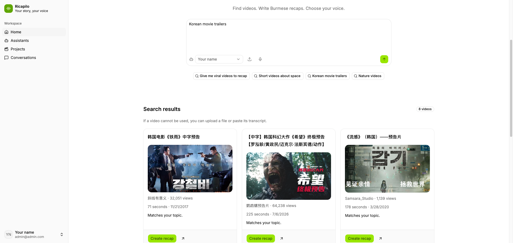

<h1 align="center">
   Ricapilo
</h1>

<p align="center">
  <a href="https://github.com/ShaungBhone/ricapilo/stargazers"></a>
  <a href="https://github.com/ShaungBhone/ricapilo/forks"></a>
  <a href="https://github.com/ShaungBhone/ricapilo/graphs/contributors"></a>
  <a href="https://github.com/ShaungBhone/ricapilo/commits/main"></a>
  <a href="LICENSE"></a>
</p>

An open-source Burmese AI recap workspace: Laravel 13 API, Next.js 16 frontend, and an isolated Remotion video renderer. Uses Bun, Docker Compose, Laravel, and shadcn.

<p align="center">
  
</p>

## Start with Docker

Install Docker with Compose and start the Docker daemon. From this directory:

```sh
sh scripts/setup.sh
docker compose up --build -d
```

The setup script generates a private `.env` containing a unique application key, database password, and renderer token. It retains an existing `.env`. Keep APP_KEY stable to preserve application encryption.

- App: http://localhost:3000
- Development email inbox: http://localhost:8025

Register an account in the app. Email verification is optional for now. To require it later, set `EMAIL_VERIFICATION_REQUIRED=true` in the root `.env` (or `api/.env` for local development) and restart the API and worker with the updated configuration. When required, open the verification email in Mailpit and follow its link in the same browser where you registered. Set `OPENROUTER_API_KEY` and `YOUTUBE_API_KEY` in the root `.env` for Docker, or `api/.env` for local development. Restart the API and worker after changing these values; for Docker, run `docker compose up -d --force-recreate api worker`. Create an assistant with a text model, transcription model, speech model, and a supported voice ID. The model catalog is discovered dynamically; there are no hardcoded voice names.

The local mail inbox is for development. Configure a real SMTP service for deployment.

### Run the queue in the background

Docker Compose includes a `worker` service that processes queued media jobs. The startup command above starts it along with the other services. To start only the worker and its dependencies, run from the project root:

```sh
docker compose up -d worker
```

The `-d` flag runs containers in the background, so they keep running after you close the terminal. The worker uses one process, one attempt per job, and a 30-minute job timeout.

Check the worker's status and follow its logs:

```sh
docker compose ps worker
docker compose logs -f worker
```

Press Ctrl+C to stop following logs; the worker keeps running. To stop the worker container:

```sh
docker compose stop worker
```

Start it again with `docker compose up -d worker`. Detached mode does not automatically restart a worker that exits or restart it after Docker restarts; the current Compose configuration has no restart policy.

### Apply code changes in Docker

The default Docker frontend runs a production build containing the code from its last image build. `docker compose up` reuses existing images, so local code changes do not appear automatically. After editing the app, rebuild and recreate the services:

```sh
docker compose up --build -d
```

Refresh the browser after the build finishes. Backend changes also require rebuilding the API and worker images so queued jobs use the latest code.

### Live frontend updates

For live frontend updates while editing code, start it with the development override:

```sh
docker compose -f compose.yaml -f compose.dev.yaml up --build frontend
```

This mounts `frontend/` and runs Next.js development mode with file polling for Docker. Dependencies and build output stay in Docker volumes. This override applies to the frontend; backend changes still require rebuilding the API and worker images.

To return to the production frontend:

```sh
docker compose up --build -d frontend
```

## Configure discovery

Discovery supports YouTube and Bilibili. Broad popularity requests use platform feeds; topic requests use searches. Results are limited to videos under four minutes, with dates and reported views. Bilibili public discovery uses `bilibili-cli==0.6.2`, installed in the API Docker image; local development requires Python 3.10 or later with `python3 -m pip install bilibili-cli==0.6.2` or a virtual environment selected with `MEDIA_PYTHON`. New Dailymotion projects are disabled; existing projects remain readable and processable.

### Get a YouTube Data API key

YouTube discovery requires one environment-configured key. Ricapilo searches public videos, so an API key is sufficient; an OAuth client or consent screen is not needed.

1. Sign in to the [Google Cloud Console](https://console.cloud.google.com/) with your Google account. Create a project (for example, `Ricapilo`) or select an existing one.
2. Open **APIs & Services → Library**, search for **YouTube Data API v3**, and click **Enable** for that project.
3. Open **APIs & Services → Credentials → Create credentials → API key**. Name the key, restrict its API access to **YouTube Data API v3**, and create it. If the restriction is shown on the key's edit page instead, select **API restrictions → Restrict key → YouTube Data API v3** and save.
4. Copy the generated key to use in Ricapilo.

For local Docker use, leave the key's **Application restrictions** set to **None** while keeping the API restriction above. Requests come from the Laravel backend, so website/referrer restrictions will not match. For a deployed server with a stable public outbound IP address, use an IP address application restriction for that address; do not use `localhost` or a private container IP.

See Google's [YouTube API setup guide](https://developers.google.com/youtube/v3/getting-started) and [API key management guide](https://docs.cloud.google.com/docs/authentication/api-keys) for current console instructions.

### Add the key to Ricapilo

Register an account in the app, then promote it using the same email address (verify it first only when `EMAIL_VERIFICATION_REQUIRED=true`):

```sh
docker compose exec api php artisan recap:admin you@example.com
```

Set `YOUTUBE_API_KEY` in `.env` and recreate the API and worker containers. Administration shows configuration status and lets administrators disable individual model IDs.

For local development without Docker, run `php artisan recap:admin you@example.com` from `api/` instead. Administrators can also disable individual model IDs. Provider API keys are read only from server environment configuration and never returned by the API. Each user's assistants, projects, files, and conversation history are private.

## Source access and generation behavior

Search results are metadata, not media access guarantees. Selection records only a supported platform and video ID. The worker attempts to retrieve available media using yt-dlp, then FFmpeg extracts audio in four-minute chunks. If a platform blocks retrieval, the project reports that failure and accepts an upload or transcript. The app never fabricates a transcript from a title.

The initial video assembly uses available source footage with Burmese narration and burned-in captions. A transcript-only or audio-only project produces a simple caption video. It does not include a timeline editor. Two basic caption styles are included: clean bottom and boxed minimal.

Caption timing is currently estimated from each narration paragraph's measured duration. It is not word-level alignment. The editor preview and MP4 export share a Remotion composition for footage, captions, text overlays, and audio.

Browser Talk uses microphone recording, silence detection, per-turn OpenRouter transcription/chat/speech calls, persisted transcript, and audio playback. It is a turn-based live conversation, not a provider-native full-duplex realtime socket. Chrome and Firefox support the implemented WebM/Ogg recording path; HTTPS or localhost is required. Headphones improve echo cancellation. Stop controls cancel local playback and suppress stale responses; an upstream request already submitted may still be billed.

## Services

- `frontend`: Next.js standalone application, exposes localhost:3000.
- `api`: Laravel on Apache; reachable only inside the Compose network.
- `worker`: long-running database queue worker with a 30-minute job timeout.
- `renderer`: authenticated internal Node/Remotion renderer, shares only project media storage.
- `database`: PostgreSQL, persistent volume.
- `redis`: cache and overlap locks.
- `mailpit`: development SMTP inbox.
- `init`: applies migrations before API and worker start.

The renderer defaults to Remotion. Set `RENDERER_ENGINE=ffmpeg` in the root `.env` and recreate the renderer to use the legacy FFmpeg composition. Remotion bundles the shared composition and Burmese fonts at image build time and installs Chrome Headless Shell. Private media is served only over render-scoped loopback URLs. A successful render atomically replaces `recap.mp4`; a failed render preserves the previous export.

The renderer has one concurrent rendering slot. A second render is rejected with a retryable project failure rather than running unbounded CPU jobs. The worker runs with one process by default. Queue retry visibility is longer than the job timeout to prevent duplicate processing.

## Local development without Docker

Requirements: PHP 8.3+, Composer 2, Node.js 24, Bun 1.3.13. Media jobs additionally need yt-dlp, FFmpeg, and ffprobe.

```sh
cd api
composer install
cp .env.example .env
php artisan key:generate
php -r "file_exists('database/database.sqlite') || touch('database/database.sqlite');"
php artisan migrate
php artisan serve --host=127.0.0.1 --port=8000
```

In another terminal:

```sh
cd frontend
bun install --frozen-lockfile
cp .env.example .env.local
bun run dev
```

Set API_INTERNAL_URL in `frontend/.env.local` to the API URL. The frontend proxies requests through `/api/backend`; authentication uses HTTP-only Laravel session cookies and CSRF tokens. AI calls and credentials stay on Laravel.

For local media jobs, run `php artisan queue:work --timeout=1800 --tries=1`. The renderer requires a matching RENDERER_TOKEN and shared MEDIA_ROOT; Docker is the supported complete setup.

Laravel Boost is installed as a development dependency. Use its generated guidelines in `api/AGENTS.md`. Unused Laravel Vite assets, welcome page, frontend package files, and demo tests have been removed.

## Checks

```sh
cd api
composer validate --no-check-publish
composer lint
# If needed: composer lint:fix, then re-run composer lint
composer test
cd ../frontend
bun run typecheck
bun run lint
bun run build
cd ../renderer
bun install --frozen-lockfile
bun run build
node --test
```

Lint uses Rector prepared code-quality sets, the Laravel Pint preset, and Prettier defaults with Tailwind sorting. `composer test` runs lint before the API suite. Install the frontend Bun dependencies before running Composer lint commands. The API has no Blade templates, so Blade-only lint is omitted. Next.js ESLint and TypeScript checks remain enabled.

API tests mock provider responses and prevent stray requests, so they do not use paid API credits. The full live OpenRouter workflow requires your own key and credits. GitHub Actions runs API, frontend, and renderer unit checks. For real MP4 export checks, build the renderer image and run:

```sh
docker compose build renderer
docker compose run --rm --no-deps -e REMOTION_RENDER_TEST=1 renderer node --test remotion.integration.test.mjs
```

## Deployment and backups

Compose is configured for local use: localhost ports, local development mail, and APP_ENV=local. Before deployment, set the external HTTPS FRONTEND_URL and matching APP_URL, configure real SMTP, set APP_ENV=production and secure session cookies, and place the frontend behind TLS. Next.js embeds API_INTERNAL_URL in its rewrites at build time; rebuild when changing that address.

Back up PostgreSQL, the media volume, and APP_KEY securely together. The renderer token and database credentials must remain private. API and renderer ports should stay internal. Keep provider models and media tools updated. Configure per-user quotas and additional workers based on your deployment's capacity.

## Roadmap

**Media & captions**

- [ ] Word-level caption alignment instead of paragraph-duration estimates
- [ ] More caption styles beyond clean bottom and boxed minimal
- [ ] Timeline editor for trimming footage and adjusting caption and overlay timing

**Sources & community**

- [ ] Additional discovery platforms beyond YouTube and Bilibili
- [x] CONTRIBUTING guide covering setup, checks, and pull request conventions
- [ ] GitHub issue and pull request templates

Want to help? Open an issue to discuss a roadmap item before starting work.

## Star history

<a href="https://star-history.com/#ShaungBhone/ricapilo&Date">
  
</a>

## Open-source scope

This repository contains the open-source application only. See LICENSE and SECURITY.md. Source repository: [ShaungBhone/ricapilo](https://github.com/ShaungBhone/ricapilo).
